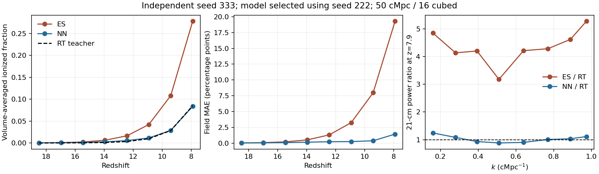

# Residual validation: 2026-10-27

The original short-history experiment has a **25.624 percentage-point (pp)**
held-out ES-to-teacher ionization-field MAE. We reproduced it exactly. It was
not evidence of accurate emulation, and the previous validation report should
have made this error prominent. New, longer-history diagnostic training reduces
held-out MAE substantially, but neither the labels nor the neural predictions
are certified photon-conserving production results.

Machine-readable evidence: [history and controlled comparisons](validation_results/history_initialization_20261027.json),
[training, selection and per-snapshot metrics](validation_results/training_20261027.json).
The JSON records configurations, hashes and numerical results; raw simulation
cubes are not committed. [Plot reproduction](validation_results/plot_validation.py).

## Experiments and conventions

These are actual compiled native 21cmFAST and modified C2-Ray runs, using
`conservative_rays`, not synthetic replacement labels. The box is 50 cMpc;
source, label and RT meshes are 16 cubed, IC DIM=48, RT refinement=1,
angular order=4 (96 rays/source), with 4096 source cells. Seeds 111/222/333
are train/validation/test respectively. MAE is the volume mean of the absolute
cellwise difference in xHII; an error of 0.01 is 1 pp. Hydrogen ionized stock
uses reference-gas mass weighting and is reported separately.

The original experiment evolves z=8 to 7.9 in one interval. The warm-history
experiment evolves z=20 to 7.9 in eight uniform-redshift source intervals.
The baseline teacher uses one transport substep per interval. Teacher initial
xHII is 1e-6, with its documented helium/temperature initialization. Density
contrast remains frozen at z=8, while cosmological proper-density dilution,
H/He chemistry, recombination, secondary ionizations and thermal evolution
remain enabled. These are still different physical/source conventions from ES.

**IC protocol matters:** original reproduction uses one native thread; warm
generation uses eight. Native IC RNG depends on thread count. The same numeric
seed therefore produces different IC hashes between these protocols. Their
errors must not be subtracted to estimate a warm-up effect. The two controlled
comparisons below reuse the exact warm-history arrays, avoiding this ambiguity.

## What caused the large residual?

For original seed 333, final ES mean xHII is 0.26235236, whereas teacher mean
xHII is 0.00611137: MAE is **0.2562409932**. ES was already substantially
ionized at z=8 (volume mean 0.24579352; mass mean 0.28898645), while the teacher
started near neutral and received only 0.00727221 nominal photons per reference
nucleus over the short interval. This compares incompatible accumulated states.
All final cell differences have the same sign, so MAE equals the mean offset;
this does not imply negligible spatial error (RMSE is 0.37364).

| Same-history control, seed 333 | Direct teacher-field MAE | Meaning |
| --- | ---: | --- |
| Restart near neutral at z=9.4125 versus retain full z=20 history | **2.64719 pp** | Effect of discarding earlier RT history, with identical final interval |
| Two substeps versus one, full identical history | **0.05003 pp** | Time-step sensitivity for this history |

The restart uses the final two warm-history endpoints, identical IC, gas
capacity, final ES field, source rates and duration. It is not a restart at
z=8. The half-step case has a 6.60 pp maximum cell difference despite its small
mean difference. Neither test establishes angular or spatial convergence.

Warm seed 333 still has ES-to-teacher MAE **19.29399 pp**, with teacher mean
xHII=0.08501157. The native source proxy is **0.35947536** per reference
nucleus, while the integrated nominal teacher photons are **0.10978377**.
These quantities have different definitions; their discrepancy is measured,
not an isolated attribution to one physical process. Frozen density contrast,
source-history construction and different gas chemistry also remain possible
contributors. We have not decomposed all of them into independent effects.

Across the eight successful cases, maximum active-band primary
absorption-plus-outflow ledger residual is **1.12e-12**. Warm seed 333 has
negligible boundary outflow (1.34e-29 of nominal emission). Lost transported
primary photons therefore do not explain this large residual. Primary
transport closure does not equate to hydrogen ionized-stock closure: the
measured active/nominal SED factor is 1.01535721, and helium, secondary events
and recombinations must remain separate in the accounting.

## Neural accuracy, including the negative result

Near-constant smoothed/global feature channels were divided by extremely small
independent standard deviations. In the exact original late-start reproduction,
the 50 cMpc radius feature reaches about 20,818 training standard deviations
on the test box, saturating 100% of the first hidden-layer activations. The
repaired scaler applies a training-only channel scale floor; the ES-only arm
then reaches at most 4.32 standard deviations, with 0.99% saturation. An
independent derivative audit found no zero-residual
dead-gradient defect; directional and endpoint tests now guard that behavior.

**Scaling repair alone does not rescue the original experiment.** On the same
three-seed, single-snapshot late-start dataset, using the same 20-epoch,
16-node, 1024-sample, model-seed-11 training protocol:

| Scaling | Validation-selected held-out MAE |
| --- | ---: |
| Original independent feature scaling | 25.62410 pp; epoch 0 |
| Repaired channel scaling | **27.49085 pp; epoch 20** |

The repaired run improves validation loss but worsens test MAE by 7.29%
relative. This is a real generalization failure and is retained in the record.

Warm training uses eight snapshots per seed, a 32-by-32 MLP and two model
seeds. Validation selects the density-plus-source feature arm at epoch 74;
test data never select weights, feature arms or checkpoints.

| Held-out seed 333 | ES baseline MAE | Selected NN MAE |
| --- | ---: | ---: |
| Mean over eight redshifts | **4.07771 pp** | **0.31563 pp** |
| z=7.9 | **19.29399 pp** | **1.42235 pp** |

With original scaling on the same warm data and training budget, validation
selects the ES-only arm: mean MAE 0.69057 pp, final MAE 2.73186 pp. Thus both
the history/data protocol and scaling matter; the warm-versus-late improvement
cannot be assigned entirely to either one.

At z=7.9, the selected NN still has **−2.91% relative hydrogen ionized-stock
bias** (−0.30358 pp absolute), **6.61143 pp front MAE**, **37.79732 pp maximum
cell error**, and field correlation 0.95686. The largest reported 21-cm power
ratio error is **24.29%** across the eight measured bins. This spectrum uses
the saturated-spin-temperature density-times-neutral-fraction proxy, without
RSD; it is not a complete observational accuracy claim. Low mean field error
does not establish accurate fronts, all Fourier modes, or conservation.

## Repairs and verification

Generation now audits initial ES/teacher compatibility before RT (default
mass-weighted tolerance 1e-3); manifest aggregation preserves failures, and
training requires explicit exploratory override for mismatched histories.
Warm z=20 cases pass; the original late-start cases fail. No automatic ES
initialization or unphysical global photon projection was introduced.
Residual audits and explicit baseline/NN reports make large errors visible.

MPI sometimes completed a run without forwarding its initialization stdout.
The native driver now writes the same measured initialization record to
`results/native_initialization.json`; the runner reads it and cross-checks
stdout when present, retaining legacy stdout fallback. This is a logging
repair. Old/new compiled outputs were verified bitwise identical. Container
MPI transport/binding workarounds stayed local and do not alter Gadi settings.
Failed attempts are excluded from scientific comparisons and recorded in the
history JSON.

Final checks reported **270 research regression tests, 240 official input
regressions and 6 compiled native tests passing**, including logging bitwise
equivalence. Test counts describe code checks, not independent physical
convergence evidence.

## Next Gadi validation

[`gadi_validate.sh`](gadi_validate.sh) defaults to
[`validation_dataset.json`](validation_dataset.json): z=20 to 5, 30 source
intervals, four seeds (two train, one validation, one test), RT refinement=1,
angular order=8 (384 rays/source) and two time substeps. It retains the
50 cMpc, 16-cubed diagnostic mesh and requests 32 CPUs, 128 GB and 48 hours;
completion time is not guaranteed. The higher-cost old default is retained
but is not this validation preset.

This extends testing through the full reionization history. It does not solve
volume, parameter, resolution or deployment-distribution coverage. All current
labels remain **`convergence_certified=false`**. Training is exploratory until
independent angular/spatial/time convergence and wider held-out accuracy are
demonstrated. The demonstrated outcome is a substantially improved small-box
ES-to-modified-RT emulator, not a certified photon-conserving NN algorithm.
