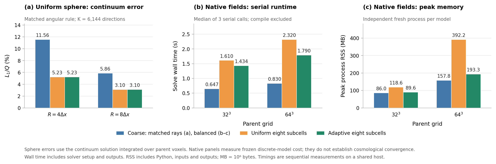

# 按需八子格前沿：实现与验证

这版将八子格前沿细化接入了 21cmFAST 的研究适配器。它保留全域八子格的空间离散模型，在需要区分方向性照明的位置才创建子格，并回收已经完全透明的子格。验证分开回答两个问题：它是否复现全域八子格，以及八子格是否比粗格更接近已知的连续解。

## 为什么可以按需展开

每个原格的八个子格具有相同密度，原有源仍放在原格中心。离散方向严格保证八个卦限各获得八分之一的源预算。一个尚未受到传播射线照射、仅由自身中心源电离的格子，八个子格的演化完全相同。在归一化时间 $u$ 上、局部气体耗尽之前，

$$
C_{i,\alpha}^{\mathrm{rem}}(u)
=\frac{C_i^{\mathrm{rem}}(0)-Q_i u}{8}.
$$

因此这一阶段可以只演化一个粗格状态。第一条传播射线到达时，先将粗格推进到该时刻，再把状态准确分成八份，并只给实际进入的子格增加照明。周期边界绕回的本源射线同样触发展开。子格完全电离并释放其射线后，可以回收整个子格块。

这里的细化判据是实际的方向性照明事件，无须预设前沿厚度。部分电离且子格状态不同的格子，必须保留八个状态直至下一步。该压缩等价性依赖于固定气体、相同子格密度、恒定源率和当前的光学厚子格模型。

## 空间精度

连续均匀球解按原格体积积分，误差定义为

$$
\epsilon_{\rm spatial}=\frac{\sum_i\left|N_{i,\rm ion}-N_{i,\rm ion}^{\rm sphere}\right|}{Q}.
$$

同方向规则、同样的 6144 个方向给出：

| 球半径 | 粗格 | 全域八子格 | 按需八子格 |
|---|---:|---:|---:|
| $4\Delta x$ | 11.56% | 5.23% | 5.23% |
| $8\Delta x$ | 5.862% | 3.103% | 3.103% |

两个球测试中，全域与按需版本的子格吸收场完全一致。该测试证明前沿几何误差下降；它不会生成原输入中不存在的子格密度信息，也不是完整宇宙学场的收敛证明。提高角分辨率仍然必要：半径 4 格、1536 个方向时，粗格和八子格误差分别为 12.70% 和 7.39%。

## 跨步状态

两个源的固定气体测试中，把一步拆成两个半步并保存子格状态，最终粗格场的差异只有 $2.30\times10^{-17}$（L1/Q）。如果把子格重新平均成父格，即使光子总账仍然闭合，最终 L1/Q 误差也达到 **1.979%**，单格电离度最大相差 **0.08203**。

实现因此保存粗格累计电离量，以及非均匀前沿格子的八个子格累计电离量；下一步通过 `initial_state` 传入。保存的气体容量指纹用于确认状态对应同一静态密度场。`initial_ionized` 只给出粗格量，会明确采用格内均匀初始状态。

## 成本与接入

两个冻结的原生源场给出以下成本。计时排除编译，每个模型先执行一次不计时求解，再交替测量三次并取中位数；输运使用单线程。RSS 来自每个模型各自的新进程，包含 Python、输入、输出和求解器，MB 为十进制单位。

| 源场 | 模型 | 求解时间 | 峰值 RSS |
|---|---|---:|---:|
| $32^3$ | 现有 balanced 粗格 | 0.647 s | 86.04 MB |
| $32^3$ | 全域八子格 | 1.610 s | 118.58 MB |
| $32^3$ | 按需八子格 | 1.434 s | 89.60 MB |
| $64^3$ | 现有 balanced 粗格 | 0.830 s | 157.77 MB |
| $64^3$ | 全域八子格 | 2.320 s | 392.21 MB |
| $64^3$ | 按需八子格 | 1.790 s | 193.30 MB |

按需版本相对全域八子格节省约 **11%／23% 时间、24%／51% 峰值内存**。相对已有的 balanced 粗格版本，输运耗时仍为 **2.22／2.16 倍**；该方法尚未达到“几乎不增加算力”的目标。这是两个不同的冻结源场，不是同一宇宙学实现的网格收敛序列；balanced 沿用自己的角度分配规则，严格空间等价性则由相同卦限方向的全域八子格对照验证。

共享主机仍有计时波动：$32^3$ 按需版三次为 1.300–1.505 s，全域版为 1.494–1.702 s；$64^3$ 分别为 1.753–1.836 s 和 2.227–2.426 s。原始样本保存在 `results.json`；首次调用未充分预热的结果也保存在 `prewarm_results.json`，不用于最终表格。

两组原生场中，按需与全域版本的粗格 L1/Q 差异约为 $10^{-17}$，最大子格电离度差异为 $1.77\times10^{-15}$。固定 384 个方向、保存完整初始前沿的 $32^3$ 第二半步测试，求解时间为 **14.437 → 12.964 s**，最大子格差异为 $6.54\times10^{-16}$。它验证静态源增量的状态续接，并不代表完整宇宙学时间收敛或现有 incremental 角度策略的生产成本。

`results.json`、`incremental_results.json`、`native_results.json` 和 `validation.json` 保存数据、运行条件、校验结果与代码指纹。独立 48 组随机混合前沿测试的最大子格 L1/Q 为 $1.82\times10^{-18}$。对整个比较矩阵的独立检查未发现局部容量超用；最大相对总账残差为 $4.83\times10^{-16}$，最大逐源残差为 $2.00\times10^{-13}$。

默认 C++ 核心使用四叉堆、48 字节射线记录和局部 DDA。射线的浮点字段与长双精度绝对穿越距离保持不变，只在范围可表示时压缩整数索引；超过范围时回退到宽记录。跨子格始终比较绝对面穿越时间，避免累加倒数步长改变近角点穿越顺序。

还比较了时间桶队列、透明块层级跳跃及面穿越时间查表。它们没有在两组原生源场中给出一致的速度收益，因此保留为实验版本。`lazy.cpp` 保留最初的按需核心，`optimized_report.md` 及各 JSON 记录实验样本与代码指纹。

21cmFAST 研究适配器可通过 `--solver adaptive-front` 选择新版本。完整 Qin20 的复合、热演化和反馈耦合尚未在这套适配器中完成；本次实际接入测试沿用已有的受限原生 coeval 配置。原有 `balanced` 默认选项保留，便于比较成本与前沿分辨率。

实际执行了 $32^3$、$z=8$ 的原生场生成、适配器输运和原生 21-cm 亮温重算，原生场生成使用 4 个线程。其按需与全域八子格的粗格 L1/Q 差异为 $1.09\times10^{-17}$，最大电离度差异为 $2.02\times10^{-16}$。这组原生流程主要验证接入；其大盒小网格不是高精度宇宙学预测配置。完整相关回归为 **294 项测试及 20 项子测试通过**，另有上述 48 个随机审查算例通过。本轮结果来自本地环境，尚未提交 Gadi 作业。

`initial_state` 只保存气体状态。每次调用显式提供新的光子预算，达到距离上限而保留的光子及逃逸光子分别记账，不会自动成为下一步的新源。当前输运核仍为串行；21cmFAST 原生场生成可以使用 OpenMP 多核。

复现命令见 [README.md](README.md)，独立等价性论证与审查见 [audit.md](audit.md)。Gadi 脚本 `research/pc_reconsidered/gadi_compare.pbs` 已包含新版本的测试与基准。
