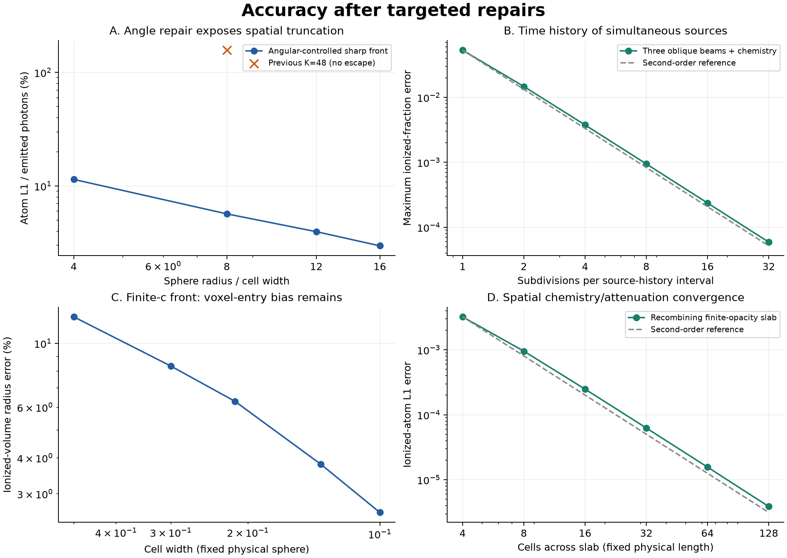

# 时空准确性修复与验证

2026-10-23，接续 `c1441606` 的独立验证。

**已修复明确定位到的数值、源历史、在途状态和复合闭合问题，并增加交叉模块验证。
完整秦20演化的“所有时间和空间准确性”尚未成立。**
本轮给出了可运行的修正实现及其误差，而不是把光子账本闭合作为物理准确性的证明。
生产 `global-budget` 保留；本轮代码只在 `research/pc_alternatives/`。

## 1. 实际修复了什么

| 原问题 | 修复实现 | 现在的行为 |
|---|---|---|
| 有限输入仍可能使总率/总预算溢出，或逐角率下溢至零，却报告成功 | `event_front.py` 数值域检查、逐源/逐角/全局事后检查 | 不支持的单位尺度在调用前拒绝；实际账本失精时报错 |
| 固定低 K 形成漏采样的射线状前沿 | `angular_accuracy.py` | 多级方向细化、两组旋转、连续两级通过；范围用独立留存上界控制；未达到要求或资源上限时返回/抛出 `unresolved` |
| 所有方向都漏掉小云时，相邻结果相同而假收敛 | 全零吸收的覆盖保护及独立反例 | 96³远处单格吸收体现在明确拒绝；有限旋转仍不是任意结构的严格误差界 |
| 累计源量反复作为新增发射；时间跳变和检查点丢失 | `source_history.py` | 积分非负瞬时率，只返回新区间光子；保存补偿累计量、时间游标和历史指纹；允许追加未来历史，拒绝改写过去 |
| 留存光子重回源头或重新各向同性发射；范围每步重置 | `finite_c_packets.py` | 保存原方向、发射时刻、当前位置、累计路程和待到达事件；关源后在途光子继续传播 |
| 简单复合追加容量把有限光深的电离区当作完全不透明 | `coupled_opacity.py` | 单束整条路径的精确光照子流、精确复合子流、多束对称分裂、时间步误差检查，保持光子和原子账本 |
| 不同方向穿过同一格却使用相同光深 | `ray_segments.py` 与 `path_tau` | 每个交段使用真实长度 `tau = sigma*n_H*length`，保留近角点的薄交段 |
| 任意历史地图被附上原始基准的代码哈希 | `validation_native_observables.py` | 读取所提供地图自己的清单；缺失来源时明确标为未知 |

这些修复没有把几种物理闭合混作同一求解器：快速事件核仍是无限光速、无复合的
不透明体素前沿；有限光速核是固定气体的光子脉冲参考；有限光深复合核目前使用无限光速。
后两者尚未合成完整的有限光速、复合、热反馈演化。

## 2. 空间与方向：降低误差，同时保留未解析标记

球参考是连续球在每格内的体积积分，误差为 `sum(abs(A-Aref))/Q`。
无逃逸 R=8 格球的固定 K48 误差为 **156.9608%**。
经过方向控制，K49152 的误差降至 **5.6805%**；相对于更高 K196608 的图差为
**0.2386% Q**，额外独立旋转的图差为 **0.3651% Q**。
此时剩余约5.7%主要由体素前沿闭合与格宽控制，不能写成总误差已低于3%。

每个网格分别通过方向检查后，R/格宽 4、8、12、16 的连续球误差为
**11.426%、5.680%、3.959%、2.972%**。这是这组球形问题的空间收敛证据。
异质密度、双源和致密薄层控制与独立高 K 旋转参考相差 **0.1792% Q**；
不透明平面后方保持零吸收。另有48组独立逐体素盒求交检查，交段长度误差不超过 `1.11e-16`。

经验角检查的限制由反例明确给出：远处单格的真实立体角份额为 `9.300236e-6`，
K3→12→48及两次旋转全部漏掉它。新增全零保护修复了这个具体误判。
**部分漏掉的细小结构仍可能逃过经验检查。** 要对任意密度场给出严格方向误差界，
还需角元可见性积分或未解析结构的可证明上界。

数值范围有更强的结论：固定源历史、静态气体、无复合条件下，沿相同射线延长路径的
吸收图 L1 改变量不超过 `min(留存光子, 剩余容量)`。这不约束角误差、有限光速、
体积加权中性度或相对功率。物理平均自由程不能被这个数值控制器任意延长。

证据：[角控制](validation_angular_accuracy.md)、[独立验收](validation_accuracy_acceptance.md)。

## 3. 时间：源积分、输运和化学分别收敛

### 源率与多源竞争

源模型明确选择积分瞬时 SFRD，而不是旧累计 `nion` 的差分。
分段线性源率的区间积分精确，源跳变显式指定。64组随机分段历史的最大积分相对差为
`1.29e-16`；累计 `1e20` 后新增 `0.001` 仍完整返回并保存补偿低位。

真实 Qin20 32³ 固定 z8 反馈，使用4个原生线程采样33个时刻，约13.28秒：

- 16→32时间段的发射图 L1/Q 为 `2.2623e-5`。
- 32段梯形→Simpson 的发射图 L1/Q 为 `7.5408e-6`。
- Simpson 总发射量为 **2833.188883**，与旧累计 ΔQ 的比为 **0.499732764**。

最后一项是时间源闭合的差别，不是 PC 丢掉了一半光子。这些原生样本固定反馈，
尚未证明逐快照反馈演化准确；原生有效光子单位也尚未替换成一致的物理 H/He 化学单位。
气体容量发生变化而没有守恒平流/重映射时，当前固定气体账本明确拒绝继续。

**积分总量精确不代表源竞争过程精确。** 新的交叉模块验证包含三束真实三维斜射线、
28个异质气体单元、10个共同照射单元、连续变化和跳变源、有限光深与复合。
独立 DOP853 与 Radau 连续时间参考相差 `3.42e-12`。

| 每段源历史的细分数 | 最大格点电离度误差 | 原子 L1/Q |
|---:|---:|---:|
| 1 | 0.05316 | 0.02025 |
| 4 | 0.003763 | 0.001497 |
| 16 | 0.0002368 | 0.00009459 |
| 32 | 0.00005922 | 0.00002366 |

光子与原子账本误差均在 `5e-17` 以内。单独把化学容差收紧，不能消除粗源时间平均的误差。
证据：[源历史](validation_source_history.md)、[三维耦合数值](validation_coupled_3d.json)。

### 有限光速与跨步状态

此前 `R=c*dt` 仍把近端目标算成吸收1的例子，现在正确给出吸收0.5、在途0.5。
在 t=0..1 发射、目标距离4.5、c=2的例子，t=3时给出吸收0.75、在途0.25，
尽管源已经关闭。输出快照不重新发射、不改变方向、不重置最大累计路程。
16组开放/周期多源脉冲，与独立预枚举交面后按到达时间扫描的参考逐格、逐源一致。

固定网格与角数，发射时间段8→256时，相对于512段的吸收图 L1/Q 从
**1.0972% 降到0.01456%**。到达跳变处的脉冲中点离散仅有一阶误差界，
不能因使用中点就普遍声称二阶前沿时间精度。

固定 K3072和128发射段，格宽0.5→0.1时，有限光速球的半径误差
**12.366%→2.583%**；吸收形态 L1/解析电离原子数 **54.82%→8.776%**。
剩余正偏差来自把整格吸收放在入口的空间闭合；正确到达时间没有消除这个格宽误差。
证据及最细网格的额外方向复核：[有限光速修复](validation_finite_c.md)。

### 有限光深与复合

先前简单追加容量在时间细化后仍给 `x=1`、透射0；新耦合实现恢复
**x≈0.591893、透射≈1.461043**。
常规屏幕、共享屏幕、反向多束和高光深控制，在 rtol=`1e-8` 时与独立同时耦合 ODE 的
最大电离度差不超过 **`2.44e-8`**。常规固定步长时间阶为 **1.9996–1.9999**。
源关闭后复合，再开启时重新吸收于已复合屏幕，不复用已经失效的透明路径。

无复合平行光柱的逐格平均值与解析解相差不超过 `9.52e-15`。
有复合薄层从4细化到128格，电离原子 L1误差从 **0.003219降至`3.879e-6`**，
与独立1024格参考比较，接近二阶空间收敛。Γ由本模型的吸收通量一致计算，并处理
中性分数趋零的有限极限；未使用原生 ES 的 Γ 代替它。
证据：[复合与有限光深](validation_coupled_opacity.md)。



## 4. 成本与尚未达到的目标

当前修复不支持“完整物理准确且成本不明显增加”的结论。
孤立128³球的最终方向控制计时约7.2秒，旧低K约0.15秒；控制器多次重算透明几何，尚未优化。
默认512MiB角相关存储保护在细化前检查，超过上限报告未解析；这不包含全部网格和缓存内存。

有限光深的高刚性控制 τ₀=1000，在严格容差下需要约38956个接受步；
最终JSON记录约8.6秒/单格，较早共享主机测量约15秒。它修复了物理闭合，
但这个高精度分裂实现不适合作为廉价生产算法。
有限光速参考也显式保留大量脉冲，当前用途是准确性基准。

仍需完成的耦合工作：

1. 统一有限光速与有限光深/复合，同时允许透明度重新增加；保持在途及吸收账本。
2. 对稀疏小尺度遮挡建立更可靠的角元积分/误差控制，并减少重复方向求解成本。
3. 接入原生逐快照源、密度守恒迁移、自屏蔽、H/He、热演化及反馈，并分别做时间细化。
4. 在相同源闭合下进行完整 Qin20 PC/not-PC、体积/质量加权中性度、互相关和21cm功率比较。

这些不能由前面的组件测试替代。标准RT测试还包括热演化、致密云遮挡以及宇宙学多源场，
可参见 [Iliev等的比较项目](https://arxiv.org/abs/astro-ph/0603199)。

## 5. 回归与复现

统一回归为 **159 tests、12 subtests全部通过**；结果及当前文件哈希记录在 `accuracy_repair_regression.json`。
原生派生32³输入的K48/192/768已重新运行，数值域保护前后吸收图**逐位不变**；
来源和观测量复核见 `validation_native_numeric_guard.json`。
生产 `src/`、`tools/`、`tests/`、`pyproject.toml` 与保留基线一致。

```bash
python -m pytest -q research/pc_alternatives
python research/pc_alternatives/run_accuracy_suite.py \
    --workers 4 --output-dir /path/to/new_accuracy_results
```

驱动并行运行独立验证；有限光速矩阵内部最多4进程。它没有把单个事件输运核并行化。
原生SFRD样本需要额外的原生构建和冻结输入，使用 `validation_source_history.py` 单独复现。

Gadi模板为 `gadi_accuracy_validate.pbs`，8核32GB，归档选定提交后运行上述验证：

```bash
qsub -v PC_SOURCE_DIR=/path/to/21cmFAST,PC_PYTHON=/path/to/python \
    research/pc_alternatives/gadi_accuracy_validate.pbs
```

这份模板运行数值验证，不是完整宇宙学模拟。本轮未在Gadi提交作业。
