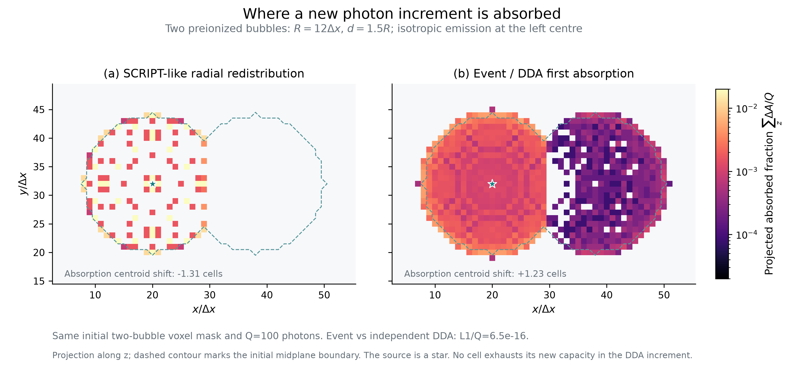

# 21cmFAST 光子守恒替代方案研究

日期：2026-10-23。当前生产方法 `global-budget` 保留，未修改或删除。

**后续独立验证见 [VALIDATION_REPORT_zh.md](VALIDATION_REPORT_zh.md)。**
本文保留上一轮研究快照及旧核计时。后续修复了小吸收相消和几何位移错误，
并分离出低角数的严重孤立球误差、源历史差别与复合闭合缺口。
完整物理准确性和低成本目标尚未完成验收。

这轮研究筛选出的主线是：**连续发射率、共享单元容量、按耗尽事件推进的电离前沿**。
已经有可运行的 C++ 原型、独立数学验证、几何收敛实验，以及来自 Qin20 的
32³ 输入场上的成本测试。它在明确的锐前沿近似下，解决了此前标量分配无法
同时解决的源预算、方向预算、前景遮挡和多源时间竞争。

目前不能称它为已经完成的、完整 Qin20 物理模拟。复合、UV背景、源发射历史、
有限传播距离的状态延续，以及大网格性能仍须接入并验证。这些是方法边界，
不是可以用“总账守恒”替代的检查。

## 1. 研究范围与保留的方案

本轮覆盖主要算法家族，审计32条论文/源码资料，并实现或重建多类可执行原型。
“探索所有可能的方法”无法成为数学上的穷尽声明；这里给出可复现的筛选依据。

| 方法 | 有效之处 | 本轮发现的限制 | 定位 |
|---|---|---|---|
| 当前 global-budget | 原生ES、源参数和热历史接口保留；全局账本明确 | 没有逐源、逐方向的合法分配保证 | 保留生产基线 |
| Park式整体校准 | 快，能修正总体再电离历史 | 总体校准不能决定重叠光子照到哪里 | 文献对照 |
| 独立球形/修改ES阈值 | 便宜、便于FFT | 每个目标判据都通过，仍可能争用同一批光子 | 不能单独解决局部分配 |
| SCRIPT式同步径向重分配 | 明确计数、现代版本有很快的实现 | 重叠后丢失原源方向；原型有角预算和时间分批反例 | 重要低成本统计基准 |
| BEORN式轮廓/组件扩张 | 几何与成本可控 | 默认平均密度体积账本不能直接代替非均匀氢原子账本 | 需另行定义模型 |
| 正核FFT匹配/最优分配类 | 可证明源和目标不超支 | 相同立体角的目标按容量吸走不同角预算；不编码第一吸收者 | 排除作为物理主算法 |
| 非重叠树/层级分配 | 计数简单、快 | 方块形态、平移依赖、方向记忆丢失 | 数学控制组 |
| 椭圆障碍/扩散模型 | 有严格局部通量和容量证明 | 扩散不等于自由传播；双球穿透角区明显错误 | 数学控制组 |
| M1/OTVET等矩方法 | 计算量不随源数线性增加 | 闭合近似有交叉光束/阴影问题 | 可选近似，非严格方向解 |
| 固定角有限体积输运 | 方向分量和局部账本可以保留 | 廉价一阶明显扩散；高阶改善但形态精度仍有成本 | 保留备用候选 |
| 公共可见前沿的FFT面通量 | 特定几何下严格局部守恒，少量FFT | 本次晚期Qin20严格证书覆盖源光子很少 | 有条件加速分支 |
| 连续事件＋直线特征线 | 逐源/角区守恒、遮挡、时间竞争同时成立 | 锐格子前沿、角离散、源数×角数内存、耦合尚未完成 | 当前首选研究方向 |

现代 SCRIPT 不能再用早期实现的“4小时”否定。2021论文报告优化后128³单图约
2–4秒；2022版本已使用同步重分配。本轮 SCRIPT-like 是我们独立重建的原型，
其反例数值没有冒充公开 Fortran 实测。同步更新本身也不是本研究的新发明。
相关原文与具体代码版本见 [literature.md](literature.md)。

## 2. 几个决定性的失败案例

**全局和逐目标判据都正确，仍不代表存在合法分配。** 一个三目标例子每格需1，
总源预算3，三个局部球形判据严格通过，但两个目标只能共享1.25光子，因此最多
合法分配2.25。必须记录源光子的排他使用，不能仅检查每格独立的球形条件。

**合法非负分配仍不等于正确方向。** 正核FFT原型对等立体角、容量100与1的两个
目标分配约0.9901与0.0099；总账正确，角预算错误。更窄的径向壳不能补回角信息。

**两球重叠是有效的物理筛选器。** 两半径R、中心距1.5R的已电离球，来自第一
球中心的相关方向满足 cosθ≥0.75，占4π的1/8。SCRIPT-like 的小增量测试在这个
方向区域分到0；扩散模型相应测试约2.8%。不能因为剩余光子被花完就认定穿透正确。
这里的1/8不是另一整个球在源处的全部视角，后者约0.127322。

**整步光子批次仍有时间竞争错误。** A光束先填P再到C，B光束直接到C；若整步
预算一次投进去，B会提前占完C，A的剩余全去自己的下游。真实的连续发射在C被
共同照亮后，应按持续的入射率分享时间。两种结果都能逐源、逐角、逐格守恒。
这说明还需要吸收的时钟，而不仅是一个更精细的总量账本。

## 3. 首选候选：连续发射率的事件前沿

假设一个演化子步内源位置、发射率、密度固定。每个源分到角方向α的发射率为

\[
r_{s\alpha}=\dot N_s w_\alpha,\qquad
w_\alpha\ge0,\quad\sum_\alpha w_\alpha=1.
\]

每条射线只照射它沿原方向遇到的第一个尚未填满的格子。对格子j，剩余中性容量
为C_j，当前总入射率为

\[
F_j=\sum_{s,\alpha:\,j\text{是第一吸收者}}r_{s\alpha}.
\]

在下一次前沿改变之前，F_j不变，因而

\[
\frac{dC_j}{dt}=-F_j,\qquad
t_{j,\mathrm{full}}=t+\frac{C_j}{F_j}.
\]

处理最早填满的格子，再把等待在该格子的射线沿原方向向前推进。其他格子不用
每次重算；只在其入射率改变时更新剩余容量。索引最小堆保存当前事件，节点数
不超过格子数。已经透明的区域可用经证明安全的空区跳跃跳过。

这个方法不是另一个局部独立ES阈值。它可以作为21cmFAST的电离分配模块，继续
使用它的源、密度和热物理接口，但不能把原生ES判定的气泡先永久电离，再假设
只输运剩余光子就能纠正全部局部错误。

它的便宜之处来自三点：

1. 不扫描整个网格上的每个方向、每个光行时间步，只处理真正改变的前沿。
2. 源自己的格子未填满时，所有方向都在这里吸收，可以严格压缩成一个标量发射率；
   只有该格子填满后才创建射线。不是把不同位置的射线随意合并。
3. 直线路径和方向保留；透明空间不需要逐格重新计算吸收。

在这套离散模型内，每条射线任何时刻都有唯一的第一吸收者或明确的外流类别。
因此源预算、角预算、单元容量同时成立。固定源和固定路径下，还可证明时间
分步一致，以及提高发射率不会降低某格子的电离量。

这是光子守恒前沿跟踪的一个事件实现；射线、前沿通过时间和自适应角划分已有
先例，不能仅因为未检索到同样的堆实现就声称新颖。推导和先例见
[event_front_theory.md](event_front_theory.md) 与
[characteristic_notes.md](characteristic_notes.md)。

## 4. 目前验证到了什么

独立图模型不调用C++事件堆，验证了解析竞争例子、并列事件、源顺序、弱源压缩，
以及100个随机图案例。最大时间分步差异约6.52e-16。

三维事件原型的结果：

- 之前SCRIPT-like中“增加光子反而使格子由1降到0.05”的双源场景，事件法没有
  格点下降；该格子随源增强上升。
- 一个完整子步与0.37+0.63两段，在固定源测试中最大差异约6.66e-16。
- 平移和共同旋转射线/几何一致；固定不旋转的有限角网格仍有角离散误差。
- 斜向不透明屏障测试没有透过屏障；第一命中位置与独立普通DDA一致。
- 两球小增量的空间沉积图与独立逐格DDA吻合到浮点误差。沉积质心朝向第二个
  球，约+1.225格；连续球面参考约+1.309格，SCRIPT-like则约−1.31格。
- 球体格点化仍有误差：按格心方向统计的角锥沉积约11.12%，不能写成空间图已经
  精确得到12.5%。12.5%是连续几何方向份额；有限角、有限网格须分别收敛。

孤立球与连续球的格内体积参考比较，随空间和角分辨率共同提高：

| 半径/格宽 | 方向数 | 电离原子场 L1 / 总光子数 |
|---:|---:|---:|
| 4 | 805 | 11.75% |
| 8 | 3217 | 5.86% |
| 12 | 7239 | 4.09% |

这支持几何收敛，但不是任意场景的统一4%误差保证。尤其不能因为多源功率谱
在48方向已经稳定，就声称48方向足以正确描述一个大孤立气泡。

## 5. 成本：使用真正的原生单步作分母

基准采用32³、DIM96、200cMpc、seed1234、Qin20物理参数，以及明确标注的粗时间
节点[35,12,8,7.5]。同一冻结输入上的4线程原生电离计算为9.606、9.708秒，中位数
9.657秒。它包含原生源积分、滤波、电离、Gamma和复合计算，不包含密度、Ts/X射线、
亮温计算及I/O。不是完整coeval运行时间，也不是Gadi结果。

最初事件核：48方向1.804秒/162MiB；192方向8.316秒/392MiB。
随后仅优化数据结构：索引堆替代陈旧事件堆、固定大小射线块替代动态大向量。
48和192方向的吸收场与优化前逐位相同，数值方法没有改变。

优化后重复测量：48方向约0.81–0.86秒，192方向约3.65–4.16秒。最后一次按顺序
执行的三档测试如下；共享主机的计时波动仍应保留在解释中。

| 方向数 | 单线程输运核 | 峰值RSS | 相对9.657秒原生电离单步 |
|---:|---:|---:|---:|
| 48 | 0.766秒 | 113MiB | 7.93% |
| 192 | 3.170秒 | 262MiB | 32.82% |
| 768 | 16.937秒 | 851MiB | 175.38% |

这些都是**额外输运核**成本，不是已经测得完整新模型总耗时增加这些百分比。
高角分辨率成本仍明显增加，不能宣称任意精度都便宜。最新测量、资源限制、原生
输入和源码哈希见 [event_native_optimized_benchmark.json](event_native_optimized_benchmark.json)。

在此原生派生输入的初始48→192角比较中：平均|ΔxHI|=0.00455，场相关系数0.9980，
模式数加权的壳功率绝对差为0.181%；最大单格差仍达0.227。这是内部角离散比较，
不是相对真实RT的物理误差。最终48→768的平均|ΔxHI|为0.00436，加权壳功率差
0.2238%，最大单格差0.219；192→768分别为0.001290、0.0743%、0.0583。
不同方向数采用的Fibonacci格点并不嵌套。有限路径上未吸收量随K不单调，均已
单独记账，没有塞进电离场。

晚期内存仍随“已激活源数×方向数”增长。当前事件核心串行；只证明了这份32³
输入上核成本合理，尚未证明128³/256³、32核Gadi或整个再电离历史的成本。

## 6. 一个独立且重要的源场问题

原生Qin20的E-INTEGRAL在每个半径，先滤波环境，再重新计算条件质量函数，且有
每个半径自己的历史和均值校正。它不是对同一张局部光子计数图反复滤波。

我们在实际输出中检验了一个必要条件：若F_R=W_R*S，原生sharp-k滤波禁止的
傅里叶模式中F_R必须无功率。原生半径源字段违反这个条件；32³例子中密度加权
解释的禁止模式功率占涨落功率约5.71%，显著高于舍入误差。

因此，不能声称“把原生半径场换成一张可加源图，物理完全没变”。按各类源全局
预算归一化的正局部源图可以定义，但在此例再滤波后的差异最高约为原生涨落
标准差的56.2%。这不是均值误差，也不是21cm功率抑制的预测。

对真正的时间演化，更好的接口是瞬时UV发射率。当前Qin20模板ALPHA_ESC=0，
已有的ACG/MCG恒星形成率密度可以乘各自常数逃逸率和光子产额，形成正发射率，
再积分每一时间步新产生的光子。一般质量依赖逃逸率则需要加权质量函数积分。
这同样要明确其时间积分与原生累计nion历史不必相等。

不能每一步重新投入累计光子，也不能把累计源图差分的负数直接截断成零。
源接口、单位、归一化和反馈闭合详见 [native_source_notes.md](native_source_notes.md)。

## 7. 尚未满足完整生产模型的部分

1. **真实发射历史。** 当前成本测试把累计源计数重新解释为一段固定发射率，
   只是相同输入下的核测试。须接入瞬时发射率和持续账本。
2. **复合、UV背景和热反馈。** 当前事件证明适用于容量单调减少、无复合的前沿。
   Qin20启用非均匀复合；不能将其关闭后仍称为完整Qin20验证，也不能将原生Gamma
   无检查地贴到全新电离拓扑上。
3. **范围、光速和未吸收光子。** 当前有限距离停止的预算记为未分配，绝非吸收。
   跨时间步继续输运，需要保留联合的源/方向/位置状态，而不只是边际总量。
   有限光速还需要到达事件和在途光子账本。
4. **空间/角/时间收敛与参考RT。** 当前有独立几何与离散模型验证，但还没有
   完整重叠源、吸收体、复合条件下的参考RT对照。
5. **大网格与并行。** 目前成本鼓励继续接入；不能用小网格外推生产性能。

另外，公共可见的透明前沿可以用精确矩形面立体角的FFT卷积计算通量，512源
立方体测试的单元散度误差约2.22e-15。它可作有证书的加速分支。但本次晚期
Qin20场中严格证书只覆盖约0.268%的源光子，不能假定大多数复杂气泡都能走这条捷径。

当前选择是保留 `global-budget` 作为稳定基线，继续推进事件前沿作为新候选；
同时保留活跃区域高阶角输运和有证书的面通量分支作为对照。旧方法没有被
未经完整耦合验证的新原型替换。

## 8. 产物与复现状态

统一自动化测试：21 tests、12 subtests通过。独立图模型、三维几何、原生源场
审计和角分辨率实验另有脚本与JSON。生产 `src/`、`tools/`、`tests/` 和
`pyproject.toml` 对保留提交的差异为零。本轮没有提交Gadi作业。

双球投影图使用相同初始几何和Q=100增量；颜色表示沿z投影的吸收量，
不是把透明气泡内部重新吸收。右图与独立DDA参考一致。

更多收敛图、脚本入口和全部证据文件见 [README.md](README.md)。
