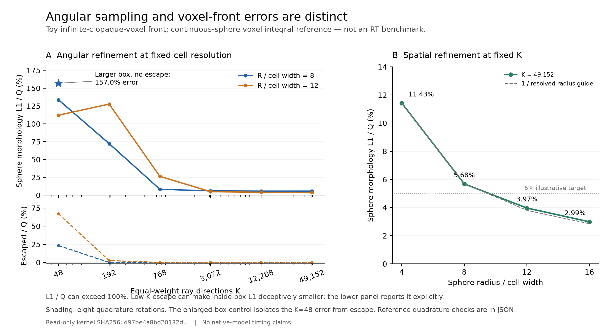

# 事件前沿候选：准确性与剩余工作的验证

后续修复与时空收敛结果见 [ACCURACY_REPAIR_REPORT_zh.md](ACCURACY_REPAIR_REPORT_zh.md)。
本页保留第一轮验证及其代码哈希；本页所列部分缺口已有组件修复，完整耦合仍未完成。

2026-10-23。本轮针对上一轮研究提交 `e3c85c31` 追加独立验证，并修复研究原型。
生产 `global-budget` 保留，`src/`、`tools/`、`tests/` 和 `pyproject.toml` 未改。

**结论：离散事件求解器的实现得到独立验证；“完整 Qin20 物理准确、且计算成本不会明显增加”尚未成立。**
主要缺口已经由具体实验定位：孤立强源的角采样、真实源历史、复合与内部辐射场，
以及准静态近似的适用范围。它们需要定义并检验物理近似，不能全部归为接口工作。

## 1. 实现准确性：发现问题、修复、独立重验

独立参考先用普通 DDA 建立每条射线的完整路径，再扫描全部射线和单元推进耗尽事件。
它不使用候选的透明距离跳跃、事件堆、弱源延迟建射线或吸收量计算代码。
参考路径和时间积分另有手算算例核对。

发现并修复两类问题：

- **大数相减丢失小吸收。** 容量为 `1e12`、新增发射 `0.001` 的单格，旧输出为
  `0.0009765625`，损失该步光子的 2.34375%；容量为 `1e20` 时完全丢失。
  现在直接补偿累计吸收量，并补偿更新剩余容量。
- **几何位移改变第一吸收者。** 旧 `1e-10` 越面位移可把边界逃逸误计为留存，
  也可跳过近角点处真实存在的薄体素交段。现在用整数体素游标和原射线上的绝对交面参数。
  每条射线仍为 64 bytes。

修复核为 `event_front.cpp` SHA256 `d97be4a8bd20132d8ed6da7314e1bef1d148c0346435d91d49fb2a36aa628fd8`。

| 独立比较 | 结果 |
|---|---|
| 严格边界、小吸收、近角点、周期循环、射线存储跨块 | 42/42 |
| 随机多源小网格 | 100/100 |
| 事件并列、单位缩放、混合容量尺度 | 24/24 |
| 固定率分步及变化源历史 | 5/5 |
| 最大格点误差 / 总发射量 | `5.78e-16` |
| 最大逐源误差 / 该源自己的预算 | `8.50e-15` |

整目录统一回归为 **68 tests、12 subtests 全部通过**（5.48 s）。其中部分测试断言
已知物理反例，表示限制能够稳定复现，不表示有限光速或完整复合已实现。
C++ 警告检查、Python 静态检查、差异格式检查通过；生产路径与保留基线一致。

原生派生 32³ 输入的 K=48、192、768 全部重新计算。修复前后吸收场最大差分别为
`6.66e-16`、`9.99e-16`、`1.11e-15`，之前这份输入上的统计结果不变。
不同真实发射历史则会改变形态：交换两个源的发光顺序，即使累计发射相同，也有
L1=5/3 的吸收分配差。实现对这些不同历史分别与参考一致。

证据：[独立核审计](validation_event_reference.md)、[数值结果](validation_event_reference_results.json)。

## 2. 形态准确性：角误差与网格误差必须分别控制

连续球参考采用每个体素内的球体体积积分，误差定义为

\[
\epsilon_A=\frac{\sum_i|A_i-A_i^{\rm sphere}|}{Q}.
\]

它可超过 100%，因为错误位置上的多余吸收与正确位置上的缺失都会计入。
单独比较球外是否逃逸可以避免小盒子掩盖错误。

| 球半径 / 格宽 | K=48 | K=192 | K=768 | K=3072 | K=12288 |
|---:|---:|---:|---:|---:|---:|
| 8 | 133.72% | 72.29% | 8.30% | 5.96% | 5.67% |
| 12 | 112.12% | 127.73% | 26.41% | 4.86% | 4.04% |

K=48 的低角采样形成不完整的射线覆盖。扩大 R=8 算例的盒子，消除全部逃逸后，
误差仍为 **156.96%**。因此这项失败不能归因于盒子太小。R=12、K=3072 在默认
方向下误差为 4.86%，但八组旋转后为 5.16–6.09%；默认一个方向相位不能作为精度保证。

固定高角分辨率 K=49152，半径/格宽 4、8、12、16 的误差分别为
**11.43%、5.68%、3.97%、2.99%**，支持空间细化收敛。
双球小增量的真正第一交面距离误差 / R 从 R=4 的 7.31% 降至 R=32 的 0.954%；
质心/R 从 0.09465 趋近 0.10761，连续参考为 0.109086。
方向标签、共有边界归属与格心分类分别统计，没有把输入 12.5% 方向份额冒充沉积图精度。



这意味着自适应方向采样是达到低成本且可靠形态的主要工作之一。
每个源用相同的低 K，无法同时覆盖弱密集源和大的孤立强源。
证据：[几何验证](validation_geometry.md)、[数值结果](validation_geometry.json)。

## 3. 多源统计：已测场中稳定，但不能代替形态与物理验证

在同一原生派生 32³ 冻结输入中，另计算密度加权中性场及

\[
B_i=\rho_i x_{{\rm HI},i}\left(1-\frac{T_{\rm CMB}}{T_{s,i}}\right).
\]

这里固定原生密度和自旋温度，没有速度映射、亮温 mK 系数或新的热反馈演化。
B 是角采样比较用的亮温代理场。K768 也是有限角参考，不是 RT 真值。

| 比较 | B 的壳功率加权差 | 最大单格 ΔxHI |
|---|---:|---:|
| 默认 K48 → K768 | 0.2411% | 0.2194 |
| 四组 K48 方向旋转 → 默认 K768，最大值 | 0.2997% | 0.2525 |
| 默认 K192 → K768 | 0.0732% | 0.0583 |
| 两组 K192 方向旋转 → 默认 K768，最大值 | 0.0518% | 0.0742 |

功率汇总为 `Σ Nmodes |P−Pref| / Σ Nmodes Pref`，不是功率比的平均。
也检查了逐壳比值、互相关和差场功率；K48 旋转测试中 B 最大逐壳功率差为 1.123%。
同一场与其反号场的解析测试具有相同自功率、互相关 −1、差场功率 4 倍，说明只看自功率为何不够。

**有限搜索范围可以做有界近似。** 对固定源历史、无复合、路径前缀相同的离散模型，
延长路径使每格吸收不减，周期边界的光子账本给出

\[
\|A_{L'}-A_L\|_1=R_L-R_{L'}\le\min(R_L,C_{\rm remaining}),\qquad L'>L,
\]

其中 R 是未分配光子数。此上界约束原子计数 L1，不直接约束体积平均 xHI 或相对功率，
也不涵盖源反馈变化或有限光速误差。
独立参考的25组路径延长案例通过该上界，含达到上界的解析例子。
在该 32³ 输入中把最大路径加倍：K48 的吸收 L1/Q 改变 `6.916e-6`，K192 为
`3.202e-6`，恰等于原有留存占比；所有留存清零。B 的加权功率差分别为
**0.00880%、0.00226%**。因此这份冻结算例的数值截断已经很小。

证据：[观测量与范围复核](validation_native_observables.json)、[复现脚本](validation_native_observables.py)。

## 4. 剩余物理工作已经有实证约束

| 项目 | 本轮验证 | 后续需要完成的工作 |
|---|---|---|
| 瞬时 UV 源 | 真实 SFRD 单位与产额/逃逸率转换得到约 `1e-7` 的原生均值恒等式核对 | 选择并验证时间源模型、可加空间源模型、密度与 H/He 归一化 |
| 源预算历史 | z8→7.5 固定反馈的 SFRD Simpson 积分 / 旧累计 ΔQ = 0.499442；Simpson/梯形 = 1.000266 | 这是一段粗历史的源模型差别；不能把新旧模拟差全部归因于 PC |
| 复合追加容量 | Strömgren **体积 ODE** 中一阶收敛；大步会失去正性 | 确定格内物理闭合与时间积分，不把 ODE 测试称为三维复合输运验证 |
| 内区吸收与 Γ | 有限光深单元参考 x=0.591893，简单追加容量在 4–256 步均给 x=1；τ₀=1000 时该 x 误差降至约 0.00467 | 验证光学厚近似的适用范围；耦合多源 Γ、持续吸收、自屏蔽与热反馈 |
| 局域化学核 | 精确子流组合的 Strang 核二阶收敛，128 步 x 误差 `1.01e-5` | 将廉价局域核与实际入射辐射耦合；目前只有给定入射率的单元核 |
| 有限光速 | 将范围设成 cΔt 仍可把应吸收 0.5、在途 0.5 的持续源算成吸收 1 | 测真实传播距离/源变化时间/前沿速度；若无限 c 近似不满足精度，增加延迟到达与在途账本 |
| 跨步状态 | 按源重新各向同性发射留存会把 0.25 光子送错方向，账本仍能闭合 | 有限 c 或保留未分配辐射时保存联合位置、方向、时间段与累计距离 |

瞬时源接口已写成可执行适配器。原生 SFRD 已含密度因子，单位是
`Msun s^-1 cMpc^-3`；再乘一次密度或把秒误当年都会出错。原生均值校准也不等于
体积积分预算校准。局部累计 MCG 场的差分实测出现一个负单元，不能普遍直接作为正发射增量。
源模型差别的具体比例仅适用于已测区间，不能推广成 Qin20 的一般源误差。

复合反例比较的是均匀混合单元与“未填满就全不透明”两个闭合，定位额外假设，
并不否定无复合事件核在其声明模型内的正确性。高光深时近似更好，需在目标尺度上检验。
局域化学一次32³/64³约 3.5/39 ms；此计时不包含计算和迭代入射辐射的成本。

实际 Qin20 默认节点在 z≈10 附近相隔约 14 Myr，对应光程约 47 cMpc。
50 cMpc 传播时间与一步相当，但准静态误差还由真实源变化和吸收距离决定。
只用步长既不能证明无限 c 足够准，也不能证明误差一定很大。
原生 SFR Hubble 时间与复合 `dtdz` 时间的细小定义差别已单独核查并记录。

详细证据：[源接口](validation_native_rates.md)、[复合/UVB](validation_recombination.md)、
[传播与状态](validation_time_state.md)。

## 5. 成本与并行：已验证的范围

修复核在原生派生 32³ 输入上单线程计时 K48/192/768 约 **1.36/5.06/19.71 s**。
这些是本轮共享主机的输运核计时，不能用旧核的 0.77/3.17/16.94 s 代替。
修复后的场只改变舍入量级，但更严格的几何计算有成本。
完整候选仍缺耦合模块，尚无完整秦20相对耗时。
低 K 未通过孤立球形态检验，不能用低 K 速度代表达到同等精度时的计算成本。

另外完成固定格宽、约1%源格、固定发射分布与路径范围的32³/48³/64³早晚期缩放，
以及每格为源的32³/48³密集控制。密集 K48 控制约 **0.963/3.511 s**、峰值
**147/349 MiB**。它们是玩具输入，不代表真实原生源场的整个再电离历史。
固定范围16格的晚期案例仍有约22.7–36.6%光子未分配；这些计时也不能解释为
已完成全部光子吸收的成本。

两个物理独立的有限范围源组，用两个进程计算与整盒结果逐位相同；该小例中
0.049 s 的多进程调用比 0.016 s 的单体还慢。源作用范围相交、特别是晚期密集源图，
不能直接这样拆分。**当前一般事件核仍是串行，未完成通用多核加速。**
证据：[缩放和并行验证](validation_scaling.md)。

## 6. 下一阶段的实验顺序

1. 固定源、密度、重组、时间与光速约定，建立相同输入的参考对照；先消除源模型变化的混杂。
2. 加入有误差控制的角自适应，必须同时通过孤立强源、重叠、阴影和密集多源场。
3. 验证复合/Γ/自屏蔽闭合及真实时间历史；低成本近似以收敛和对照结果选择。
4. 用留存预算控制数值范围；另外检验无限 c 近似。必要时才扩展有限 c 的在途状态。
5. 再完成一般多核、较大真实网格、检查点恢复和完整 Qin20 PC/no-PC 配对演化。

物理基准可采用 [Iliev et al. 2006](https://arxiv.org/abs/astro-ph/0603199) 的
等温电离区增长、密集云遮挡和多源场，并增加源关闭与复合后再遮挡。
当前原型没有完成这套三维耦合基准。本轮没有提交 Gadi 作业。

复现测试入口：

```bash
python -m pytest -q research/pc_alternatives
python research/pc_alternatives/validation_event_reference.py
python research/pc_alternatives/validation_geometry.py
python research/pc_alternatives/validation_recombination.py
python research/pc_alternatives/validation_time_state.py
```

原生源、观测量与缩放脚本各有 `--help`；前两者依赖可按上一轮脚本重建的冻结输入。
历史证据保留原哈希，新验证文件记录修复后的哈希，二者没有混用。
